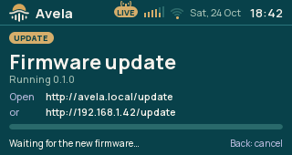
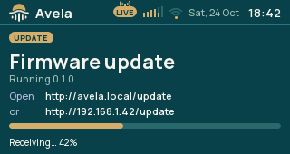

# Firmware updates

A network update replaces the application while preserving saved settings. You need the correct application image
for your board and desired skin, a reachable radio, and a browser or avela-tuner.

For first installation or USB recovery, use
[Install or recover the firmware](../../../../docs/user/INSTALLATION.md). That guide distinguishes an update that
keeps settings from a full image that erases them.



## Prepare an update

Use `avela_firmware.bin` from the intended firmware package. Do not upload `avela_firmware_full.bin`, a ZIP archive,
a bootloader or a partition-table image. Confirm the package matches your hardware; acceptance of an Avela
application name is not a substitute for selecting the right board and skin.

Make a [settings backup](../../../avela_setup/docs/user/USB.md#back-up-settings) before changing firmware if you
need a recoverable copy. Keep the radio powered throughout the upload and restart.

## Update from a browser

1. Press Back as needed to reach the screen menu. Turn to Info and press the knob.
2. Double-press the knob to open Firmware update. Keep that screen open; the radio accepts uploads only while it is
   open.
3. From your phone or computer, open the upload address shown on the screen. With the default name on your home
   network, it is `http://avela.local/update`. You can use the radio's numeric address followed by `/update`
   instead.
4. On your home network, log in with user name `avela-admin` and the page password. For a missing or forgotten
   password, follow [page access and recovery](../../../avela_setup/docs/user/SETUP.md#set-or-reset-the-page-password).
5. Choose `avela_firmware.bin` and press Update. JavaScript must be enabled for this upload page.
6. Watch progress on the radio and read the browser's result. A successful upload shows restarting, and the radio
   restarts shortly afterward.
7. Let the new firmware run for at least 30 seconds without resetting or removing power. Then open Info and check
   the running version.

You cannot leave Firmware update while receiving the image or waiting to restart. When it is only waiting for an
upload, Back returns to Info and disables uploads. After a failed upload, Back is available again.



The [setup-page login](../../../avela_setup/docs/user/SETUP.md#open-the-page) also protects the upload page.
Opening the device's update screen permits uploads; close it when you are done.

## Update with avela-tuner

The tuner sends this command over the network, not over its USB configuration connection. The radio must be
reachable at the address you give. Open Firmware update on the radio first, just as for the browser:

```sh
avela-tuner update <path-to-avela_firmware.bin> --address <radio-address> --password "<PAGE_PASSWORD>"
```

For `<radio-address>`, use a host name such as `avela.local` or the numeric address from Info, without `http://` or
`/update`. Without the option, the tool uses `AVELA_ADDRESS` if set, then `avela.local`.

Replace `<PAGE_PASSWORD>` with the page password. The tuner supplies user name `avela-admin` automatically.
Alternatively, set `AVELA_PASSWORD` in your terminal's environment and omit `--password`. The tuner checks the
login before sending the image; a missing or wrong password, or no password set yet, refuses the update with exit
code 6. Use [page-password recovery](../../../avela_setup/docs/user/SETUP.md#set-or-reset-the-page-password) if
needed.

After success, follow the same restart and 30-second waiting step as for a browser update. The
[USB guide](../../../avela_setup/docs/user/USB.md) covers the tuner's other commands.

## If the radio returns to its previous firmware

With rollback enabled, a new network-installed image confirms itself after 30 seconds of running. A crash or restart
before that confirmation makes the bootloader return to the previous image on the next start. The standard firmware
configuration enables rollback.

Released firmware versions have different version numbers, so Info can identify a return to an older release.
Development builds can share the same `-dev` version: in that case, check the behaviour you expected to change
rather than relying on the version number alone.

If the radio returns to its previous firmware, check that it was allowed to remain running through the confirmation
interval. If the new firmware repeatedly fails, keep the working version and report the failed version and what
happened. USB-flashed images do not use this network-update confirmation step.

## Update problems

| Message or symptom | What to do |
|---|---|
| The browser asks for a login | Use user name `avela-admin` and the page password. |
| Wrong or missing page password | Supply it through `--password` or `AVELA_PASSWORD`, or follow [page-password recovery](../../../avela_setup/docs/user/SETUP.md#set-or-reset-the-page-password). |
| No page password yet | [Set the page password](../../../avela_setup/docs/user/SETUP.md#set-or-reset-the-page-password) before updating on the home network. |
| The radio doesn't accept updates now | Open Info, double-press the knob and keep Firmware update open. |
| An update is already running | Wait for the active upload or restart to finish. |
| File too short, not an Avela firmware, or larger than an app slot | Recheck that you selected the matching application image, extracted from its package. |
| The image is damaged or not for this chip | Obtain the correct file again and check its checksum if supplied. |
| The upload broke off | Check the connection, reopen the update screen if needed and retry. A stalled upload eventually fails instead of waiting forever. |
| Browser loses contact during restart | Allow the radio to start, then check Info and reload using its current address. |
| The previous version reappears | Follow the rollback explanation above. |

A failed upload does not select the incomplete image for the next start. The current firmware remains the running
application. The screen reports the reason; use that reason when deciding whether to retry or replace the file.
