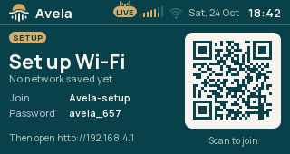

# Wi-Fi

Avela joins your home Wi-Fi to receive radio streams, fetch weather and set its clock. For initial setup it can
create its own temporary network, which your phone or computer joins to enter the home-network details.

The two networks have different names and passwords. Your home-network password is saved on the radio; the temporary
setup network uses the details shown on its screen.
The [page password](../../../avela_setup/docs/user/SETUP.md#set-or-reset-the-page-password) is a separate login
for opening settings on your home network.

## Connect for the first time

Have your 2.4 GHz Wi-Fi name and password ready. The radio shows the details for joining its setup network and
opening the setup page.

1. On Radio, press Back to reach the screen menu. Turn to Info and press the knob.
2. Hold the knob until Wi-Fi setup opens, then release it. Wait for the setup-network details and QR code to appear.
3. Scan the QR code with your phone, or join the displayed network manually. The QR code joins Wi-Fi; it is not a
   link to the settings page.
4. Stay connected if your phone reports that this network has no internet. If the setup page does not open
   automatically, open `http://192.168.4.1/` in the browser, using the address on the radio if it differs.
5. Open Access and [set the page password](../../../avela_setup/docs/user/SETUP.md#set-or-reset-the-page-password).
   Do this before saving Wi-Fi so you can open settings after setup closes.
6. In the Wi-Fi tab, enter your home-network name in Network and its password in Password. The network name must
   match exactly.
7. Press Save for that network form. Follow [After saving](#after-saving) below.

The default setup-network name is `Avela-setup`, with password `avela_657`. Use the details shown by your radio if
they differ. The setup network opens only when you request it; an unset or unreachable home network does not open it
automatically.

The page normally needs no login on this setup network. If it asks for one, follow the
[page-access and recovery instructions](../../../avela_setup/docs/user/SETUP.md#set-or-reset-the-page-password).

## After saving

Saving network credentials closes the setup network and starts a connection attempt with the saved values. This
happens even when the values are unchanged, and even if the new connection will fail. Your phone disconnecting from
setup is therefore expected; it does not prove that the home-network connection succeeded.

The radio returns to Info when setup closes. Check its Network and Address rows. Reconnect your phone or computer to
the same home network before opening the setup page there. [Setup page](../../../avela_setup/docs/user/SETUP.md)
explains the home-network addresses.

If the radio cannot join, open Wi-Fi setup again and correct the values. Pressing Back while setup is open closes
the temporary network without changing the saved credentials.

## Change the home network

Open the [setup page](../../../avela_setup/docs/user/SETUP.md), log in and choose Wi-Fi. Enter the new Network and
Password and save that form. The old connection ends, so the browser page may stop responding. Connect your phone
or computer to the new network and check Info for the radio's new address.

The browser deliberately leaves Password blank when it shows the form. Enter the password each time you save the
network form, even when keeping the same network. Saving a blank Password configures an open network; it does not
keep the previous password. Password handling in the [USB tuner](../../../avela_setup/docs/user/USB.md) differs
because unchanged fields are omitted there.

Network names can use up to 32 bytes of text. A password is empty for an open network or has 8–63 bytes of text.
Non-ASCII characters can use more than one byte each in either field.

## Change the radio name

The Wi-Fi tab has a separate Radio name form. This changes the name used in an address such as
`http://avela.local/`.

1. Enter a name with 1–31 lowercase letters, digits or hyphens. A hyphen cannot be first or last.
2. Save the Radio name form.
3. [Restart the radio](../../../avela_boards/docs/user/DEVICE.md#restart-the-radio). The new name takes effect after
   restart.

Use a different name for each radio on the same network. Saving only the Radio name form does not replace your Wi-Fi
credentials.

## If connection fails

Check the network name and password, confirm that the router provides 2.4 GHz Wi-Fi, and try closer to the router. A
failed attempt is retried after 30 seconds. If a working connection is lost, the radio starts trying to rejoin
immediately; you do not need to restart it when the router returns.

Home-network join attempts pause while the setup network is open. Finish setup or press Back to close it when you
want normal connection attempts to resume.

If your phone keeps abandoning the temporary network, choose its option to remain connected without internet and
return to the browser. For page-access problems after the radio has an address, use the
[setup-page checks](../../../avela_setup/docs/user/SETUP.md#if-the-page-does-not-open).
