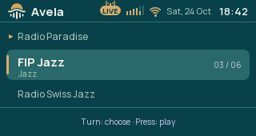
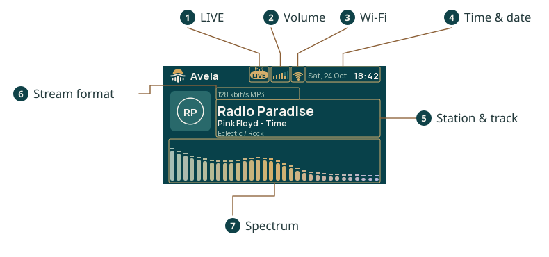

# Radio and stations

The Radio screen shows the selected station and its playback state. Once the radio has joined Wi-Fi, it can receive
an MP3 stream from that station. Its supplied list is editable from the setup page.

## Listen and adjust volume

Open Radio from the screen menu. Press the knob to start or stop playback, and turn it to adjust volume. Volume runs
from 0 to 100; 0 is silent. The [status bar](../../../avela_status_tray/docs/user/HEADER.md) shows the volume and
playback indication while you use other screens too.

Avela remembers the selected station, volume and whether playback was requested. It saves them 10 seconds after the
last change. Allow that interval before removing power if you want the latest choice remembered. A radio stopped
before that save remains stopped after restart.

## Choose a station

1. On Radio, double-press the knob to open Stations.
2. Turn to the station you want. The selection and the currently playing station can be different.
3. Press the knob to select it, start playback and return to Radio.

Press Back instead to return without choosing another station. Opening the list does not itself change the station.

## Read the player

The [player screen](media/screen-guide.svg) shows the station name and genre from your saved entry. The smaller
stream information comes from the station itself. A station can play normally without supplying an artist or song
title. The initials beside its name identify the station; they are not downloaded artwork.

| Message | Meaning and next step |
|---|---|
| Stopped | Press the knob to request playback. |
| Waiting for Wi-Fi | Playback is requested but the home network is unavailable. Check [Wi-Fi](../../../avela_network/docs/user/WIFI.md#if-connection-fails). |
| Connecting… | The radio is opening or buffering the stream. |
| The station doesn't answer | Reception failed; the radio retries. Try another station if this persists. |

The spectrum shows activity in the decoded audio. It is measured before the volume setting, so its bars can still
move at volume 0.

## Play from the setup page

Open the [setup page](../../../avela_setup/docs/user/SETUP.md) and choose Player. Select a Station and Volume, then
press Set to apply them. The button beside Set is Play while stopped and Stop while playing. Selecting a different
station and pressing Set keeps the current play/stop choice; use Play when you also want playback to start.

The Now line reports the station and state when the page was loaded. Reload the page to see a later state. If the
radio says a command was sent but not carried out yet, check the device before sending it again.

## Add a station

The radio has 16 station slots. On the setup page, open Stations and find the New station in slot form. Only the
first free slot is shown; another appears after you save a new station and reload the page. When all slots are
occupied, remove an entry before adding another.

Fill in these fields and press that form's Save button:

| Field | What to enter |
|---|---|
| Name | A name to show on the device; required |
| Genre | An optional description |
| Stream address | The station's direct HTTP or HTTPS MP3-stream URL |

A website address or a browser player page is not a direct stream. AAC streams and playlist files such as `.pls` and
`.m3u` are not supported. If a station offers several formats, obtain its MP3 stream address.

Names and genres each allow 32 bytes of text, and stream addresses allow 200 bytes. Non-ASCII characters can use
several bytes each, so the number of visible characters may be smaller. The browser saves one station form at a
time; save each edited entry separately.

## Edit or remove a station

Open Stations on the setup page, change an entry and save its form. To remove one, clear its Stream address and
save. The radio requires at least one station and refuses removal of the last entry.

Slots are storage positions, not a playlist reordering control. There is no drag-to-reorder action. The device lists
the occupied slots in their slot order.

## After editing

Changes are saved on the radio. Its station list reloads automatically. If you remove the selected station,
selection falls back to the first remaining entry.

In the official skins, an already open Stations screen can still show old text after a remote edit that leaves the
list length and selection unchanged. Turn to another entry or leave and reopen Stations to redraw it. This does not
require another Save.

## If a station does not play

Check Wi-Fi first. If the screen says Stopped, request playback; if audio is active but silent, check volume. Try
another saved station to distinguish one failed stream from a general connection problem.

For a custom entry, check that its address begins with `http://` or `https://` and points to MP3 audio. Saving an
address validates its form, not whether the station is reachable or serving a supported stream. HTTPS streams also
need a valid server certificate.

The receiver retries a failed connection after 5 seconds. An open connection that stops sending can take about 15
seconds to fail before that retry. Brief buffering is normal when changing stations; persistent failures need a
different address or a network check.
