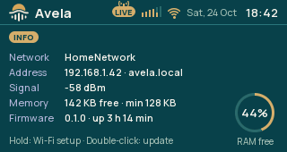

# Info

Info shows the radio's connection and device details. From the screen menu, turn to Info and press the knob. Use it
to find the setup address, check Wi-Fi and identify the firmware when reporting a problem.

| Row | What it tells you |
|---|---|
| Network | The saved home-network name and its connection state; Not configured means no home network is saved. |
| Address | The radio's current address and local name, available after it joins the network. |
| Signal | The Wi-Fi signal measurement; it is meaningful while connected. |
| Memory | Current free working memory and the lowest free value since startup, labelled in KB. |
| Firmware | The running version and time since restart; a `-dev` suffix identifies a development build. |

An en dash marks a value that is not currently available. Free memory is working RAM, not the number of station
slots or space for an update file. The RAM free ring shows the free-memory percentage. Include these details
with the firmware version when reporting a problem.

## Open connection and update screens

Hold the knob to open [Wi-Fi setup](../../../avela_network/docs/user/WIFI.md), or double-press it to open
[Firmware update](../../../avela_firmware_update/docs/user/UPDATE.md). Release the knob after the action occurs.

Back returns to the screen menu. Turning and pressing the knob on Info still control playback as described in
[Controls](../../../../docs/user/CONTROLS.md).

If the radio has an address but its `.local` name does not open, use that address in your browser. The
[setup-page guide](../../../avela_setup/docs/user/SETUP.md) explains access from the same network.
