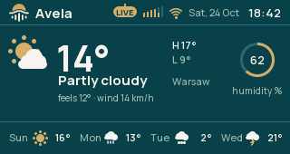

# Weather

Weather shows current conditions, temperature and feels-like temperature, humidity, wind, today's high and low, and
the next four days. It uses Open-Meteo and needs an internet connection; no API key is required.

If Weather is absent from the screen menu and setup page, it is not included in the installed firmware. There is no
setting on the radio that adds it to such a build.

## Choose a place and units

1. Open the [setup page](../../../avela_setup/docs/user/SETUP.md) and choose Weather.
2. Enter a city or place in Place. Include more identifying text if its name is ambiguous.
3. Choose metric units, °C and km/h, or imperial units, °F and mph.
4. Press Save. The radio looks up the place when online and requests its weather.
5. Open Weather from the radio's screen menu to see the result. Reload the browser tab to check its Found location
   text.

The place allows up to 40 bytes of text. Non-ASCII characters can occupy several bytes each. Check the Found result
if the weather seems to belong to another city; change the place text and save again if necessary.

## Refresh or turn weather off

Avela normally refreshes weather every 15 minutes; the interval can differ in a custom firmware build. To request a
refresh, open Weather and hold the knob, then release. A request already underway finishes before another can begin.

Saving a location or unit change and reconnecting Wi-Fi also make a refresh due. If a request fails, the radio
retries after one minute.

To stop fetching weather, clear Place and save. The Weather screen remains available but shows that no place is
configured.

## Read the forecast

Temperatures are whole degrees in the chosen unit system. Today's high and low accompany the current conditions; the
four forecast entries cover the following days. The day/night symbol is part of the weather report.

During a refresh or a connection problem, earlier values can remain visible with a status indication. Those values
are the previous successful report, not proof of a fresh update. Changing the place or units clears values that
belong to the old settings while the new report is fetched.

## Messages and recovery

| Message or symptom | What to do |
|---|---|
| No weather yet | Set a Place in the Weather tab. |
| Waiting for Wi-Fi | Check the radio's [Wi-Fi connection](../../../avela_network/docs/user/WIFI.md#if-connection-fails). |
| Loading weather… | Allow the current lookup or forecast request to finish. |
| Place not found | Correct or clarify Place and save again. |
| No weather, or old values remain with a failure indication | Check internet access and allow the automatic retry, or request a manual refresh. |
| Wrong city | Check Found on the setup page and save a more specific place. |

If Weather is loading while the rest of the radio responds, that alone does not mean it has stopped working. Avoid
repeatedly saving or holding the knob while the same request is in progress.
