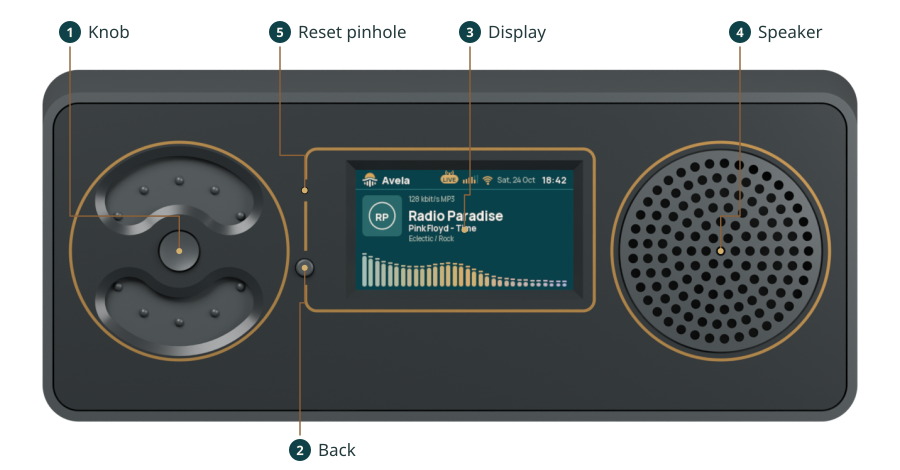
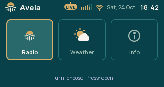

# Controls

The knob turns and presses. Turn it to change volume while listening, or to move through a menu or list. Press to
start or stop playback, or to open the selected item. The Back button returns to the previous screen.

A double press and a hold have additional actions on some screens. Hold until the action occurs, then release. The
screen hints identify the actions available there.

## Piccolo front panel

Use the [front-panel diagram](../../components/avela_boards/docs/user/media/front-panel-guide.svg)
to find the controls on Piccolo. Their positions can differ on another enclosure.

## Open a screen

Avela starts on Radio. Press Back to open the screen menu, turn to a tile, and press the knob to open it. The tiles
are Radio, Weather when available, and Info. Returning to the menu selects the screen you just left.

Stations opens from Radio. Wi-Fi setup and Firmware update open from Info. They are child screens, so Back returns
to Radio or Info rather than directly to the menu. Back has no action when you are already at the screen menu.

## Controls on each screen

| Screen | Turn | Press | Double press | Hold | Back |
|---|---|---|---|---|---|
| Screen menu | Move between tiles | Open selected tile | — | — | Stay in the menu |
| Radio | Change volume | Play or stop | Open Stations | — | Screen menu |
| Stations | Move between stations | Play selected station and return to Radio | — | — | Radio |
| Weather | Change volume | Play or stop | — | Refresh weather | Screen menu |
| Info | Change volume | Play or stop | Open Firmware update | Open Wi-Fi setup | Screen menu |
| Wi-Fi setup | Change volume | Play or stop | — | — | Close setup network; return to Info |
| Firmware update | Change volume | Play or stop | — | — | Info, except during upload or restart |

A dash means that gesture has no action. Turning through the screen menu stops at its ends. On Stations, the knob
chooses an entry rather than changing volume.

## Keep listening while using other screens

Playback continues when you open the menu, Info or Weather. On screens where the knob has no selection to move, it
still changes volume and toggles playback. Opening a screen does not itself stop the radio.

The [status bar](../../components/avela_status_tray/docs/user/HEADER.md) remains above the active screen so you can
see playback, volume and Wi-Fi state.

## Buttons on a CYD-based build

On the supported CYD-based Piccolo board, the module's BOOT button is Back while Avela is running. The reset button
restarts the device; it does not go back a screen. Holding BOOT during reset has a separate
[USB flashing function](../../components/avela_boards/docs/user/DEVICE.md#boot-and-reset).
